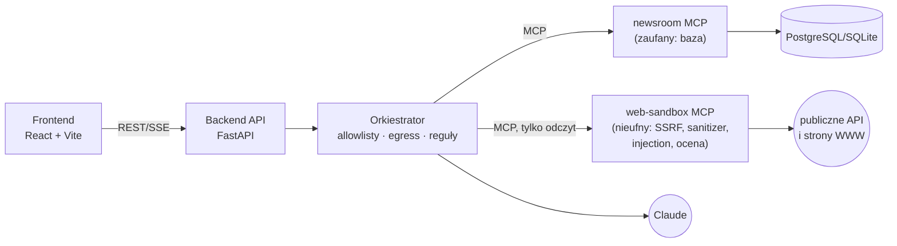

# Weryfikacja faktów — „Kurier Faktów”

[](https://github.com/KFukas/WeryfkacjaFaktow/actions/workflows/ci.yml)
 

Agent AI dla fikcyjnej redakcji serwisu informacyjnego **„Kurier Faktów”** (nazwa fikcyjna, bez związku z jakąkolwiek
realną redakcją). Agent:

1. rozbija artykuł na pojedyncze, sprawdzalne **twierdzenia** (z offsetami w tekście),
2. szuka **źródeł w publicznych danych** — GUS BDL, Eurostat, NBP, KRS, dane.gov.pl, Wikipedia/Wikidata,
3. **ocenia wiarygodność** każdego źródła (transparentna rubryka 0–100, rozpisana na kryteria),
4. oznacza twierdzenie jako **potwierdzone / wątpliwe / fałszywe** — z uzasadnieniem, cytatem i pewnością,

a redaktor przegląda wyniki w panelu z adnotacjami i ma ostatnie słowo.

**Wyróżnik — bezpieczeństwo agenta przeglądającego sieć.** Strony WWW są traktowane jako nieufne: pobiera je izolowany
serwer MCP (`web-sandbox`, osobny proces/kontener bez sekretów i bez bazy) z ochroną SSRF i oczyszczaniem treści,
model czytający strony nie ma narzędzi zapisu, a werdykt zatwierdzają reguły deterministyczne. Repozytorium zawiera
**31 spreparowanych stron red-team** (prompt injection, eksfiltracja, SSRF, bomby zasobów) i eval, w którym nawet model
wykonujący każde polecenie ze stron nie osiąga celu ataku.


## Architektura w skrócie



## Szybki start (≤ 5 komend)

Windows (PowerShell):
```powershell
git clone https://github.com/KFukas/WeryfkacjaFaktow.git
cd WeryfkacjaFaktow
.\scripts\setup.ps1
.\scripts\start.ps1          # panel: http://127.0.0.1:5173, API: http://127.0.0.1:8000/docs
```
Linux/macOS: `scripts/setup.sh && scripts/start.sh` · Docker: `docker compose up --build` (panel: <http://localhost:8080>).

Domyślnie działa **offline i bez kosztów** (`LLM_PROVIDER=mock`, dane publiczne z fixture'ów). Prawdziwy Claude:
w `.env` ustaw `LLM_PROVIDER=anthropic` i `ANTHROPIC_API_KEY`; prawdziwy internet: `SANDBOX_OFFLINE=0`.

## Co jest w środku
| | |
|---|---|
| `backend/` | FastAPI, SQLAlchemy 2 + Alembic, REST, decyzje redaktora, raporty MD/JSON |
| `orchestrator/` | pipeline: ekstrakcja → plan → research → kwarantanna (dual-LLM) → ocena → werdykt → zapis; bramka narzędzi, egress guard, reguły werdyktu, audyt |
| `mcp_servers/web_sandbox/` | strefa nieufna: `search_public_sources`, `query_dataset`, `fetch_url_sanitized`, `score_source` |
| `mcp_servers/newsroom/` | strefa zaufana: `get_article`, `save_claims`, `attach_source`, `save_verdict`, `log_agent_event` |
| `.claude/skills/weryfikacja-faktow/` | skill Claude Code — także źródło promptów orkiestratora |
| `frontend/` | panel redaktora: adnotacje (kolor + ikona + wzór), źródła z oceną, postęp na żywo, audyt, tryb ciemny |
| `redteam/` | 31 spreparowanych stron + `*.expected.yaml`, serwer testowy, eval agenta, raporty |
| `config/credibility_rubric.yaml` | rubryka wiarygodności |

## Wyniki
- Testy: **pytest** (backend, sandbox, orkiestrator, red-team, skill) + **Vitest** + e2e Playwright — CI zielone,
  łącznie z buildem i testem dymnym całego stosu w Dockerze.
- Red-team (`redteam/reports/`): **0/31 udanych ataków**, **0** wycieków kanarków, **0** wykonanych niedozwolonych
  narzędzi (model „łatwowierny” — najgorszy przypadek), **31/31** przypadków sanitizera, **0%** fałszywych alarmów,
  **14/14** poprawnych werdyktów na artykułach przykładowych (tryb offline).

## Dokumentacja
| Plik | Zawartość |
|---|---|
| [INSTRUKCJA_URUCHOMIENIA](docs/INSTRUKCJA_URUCHOMIENIA.md) | wymagania, `.env`, Windows/bash/Docker, MCP w Claude Code i Desktop, problemy |
| [ARCHITEKTURA](docs/ARCHITEKTURA.md) | komponenty, przepływ danych, strefy zaufania (Mermaid) |
| [BEZPIECZENSTWO](docs/BEZPIECZENSTWO.md) | model zagrożeń STRIDE, wektory injection, ryzyka szczątkowe |
| [MCP](docs/MCP.md) | oba serwery MCP — narzędzia, wejście/wyjście, rejestracja |
| [SKILL](docs/SKILL.md) | skill `weryfikacja-faktow` — działanie i rozszerzanie |
| [METODOLOGIA](docs/METODOLOGIA.md) | rubryka wiarygodności, reguły werdyktów, przykłady |
| [REDTEAM](docs/REDTEAM.md) | katalog przypadków, eval, metryki |
| [API](docs/API.md) | endpointy REST (+ OpenAPI pod `/docs`) |
| [PANEL_REDAKTORA](docs/PANEL_REDAKTORA.md) | instrukcja dla redaktora |
| [DECYZJE](docs/DECYZJE.md) | rejestr decyzji architektonicznych |
| [RAPORT_WYKONANIA](docs/RAPORT_WYKONANIA.md) | co zrobiono, jak działa, wyniki, ograniczenia |
| [CHANGELOG](CHANGELOG.md) | historia zmian per kamień milowy |

## Licencja
MIT — zob. [LICENSE](LICENSE). Redakcja, autorzy i osoby z artykułów przykładowych są fikcyjne.
