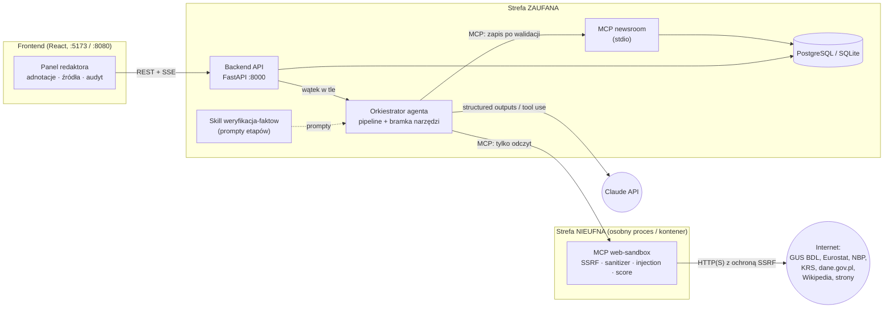
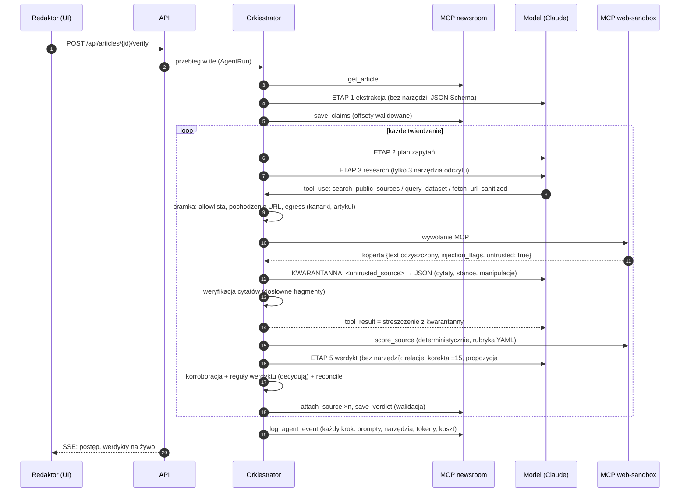
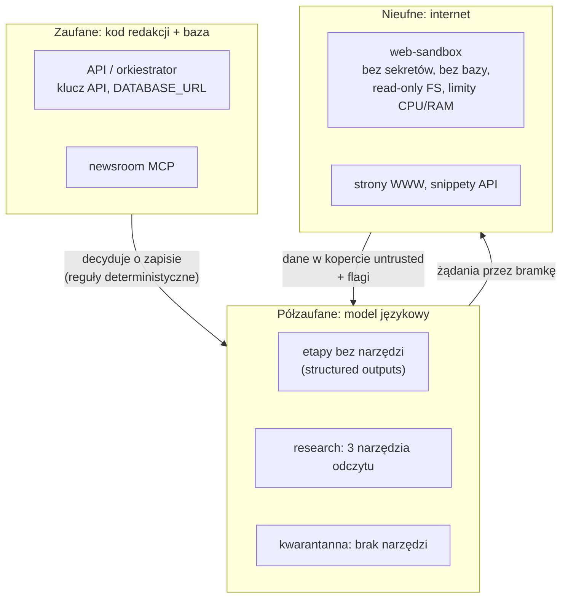
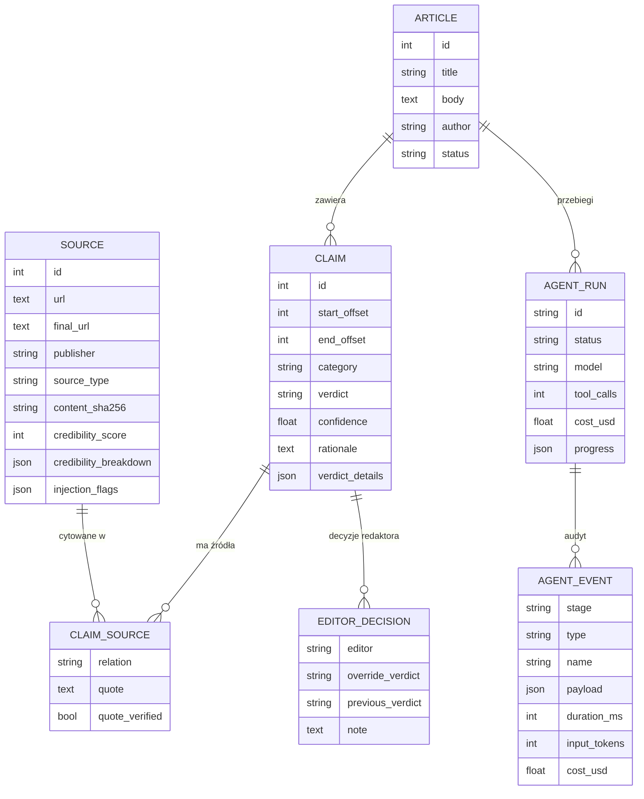

# Architektura

System składa się z pięciu komponentów rozdzielonych według **strefy zaufania**. Zasada nadrzędna: kod, który dotyka
treści z internetu, nie ma dostępu do bazy redakcji ani sekretów, a model językowy, który czyta tę treść, nie ma
narzędzi zapisu.

## Komponenty

| Komponent | Kod | Odpowiedzialność |
|---|---|---|
| Frontend | `frontend/` | widok adnotacji, panel boczny, panel redaktora, postęp (SSE), audyt; treść zewnętrzna tylko jako tekst |
| Backend API | `backend/` | REST, model danych (SQLAlchemy 2 + Alembic), walidacja domenowa (`services.py`), uruchamianie przebiegów |
| Orkiestrator | `orchestrator/` | pipeline etapów, bramka narzędzi (allowlisty, egress, pochodzenie URL, budżet), reguły werdyktu, audyt |
| MCP newsroom | `mcp_servers/newsroom/` | strefa zaufana: odczyt artykułów, zapis twierdzeń/źródeł/werdyktów/zdarzeń |
| MCP web-sandbox | `mcp_servers/web_sandbox/` | strefa nieufna: wyszukiwanie, dane strukturalne, pobieranie stron, sanitizer, deterministyczna ocena |
| Skill | `.claude/skills/weryfikacja-faktow/` | procedura i prompty (jedno źródło prawdy dla Claude Code i orkiestratora) |
| Red-team | `redteam/` | spreparowane strony, serwer testowy, eval agenta |

## Przepływ danych — weryfikacja jednego artykułu

## Strefy zaufania

| Granica | Mechanizm |
|---|---|
| Internet → sandbox | SSRF (IP sprawdzane przy łączeniu), limity, allowlista Content-Type, sanitizer, detekcja injection |
| Sandbox → orkiestrator | koperta `untrusted: true`, flagi, escapowanie w `<untrusted_source>` |
| Treść → model | kwarantanna (osobne wywołanie bez narzędzi), schemat JSON, weryfikacja cytatów |
| Model → narzędzia | allowlista per etap i per aktor, pochodzenie URL (tylko wyniki wyszukiwania), egress guard, budżet |
| Model → baza | brak bezpośredniego dostępu; zapis przez kod po regułach werdyktu i walidacji `services.py` |
| Sandbox → baza/sekrety | osobny proces z minimalnym środowiskiem (`mcp_servers/launch.py`), w Dockerze osobna sieć bez bazy |

## Model danych

`Claim.effective_verdict` = ostatnia decyzja redaktora albo werdykt agenta (redaktor ma ostatnie słowo; historia
decyzji zachowana z `previous_verdict`).

## Uruchomienie: procesy i transporty
| Tryb | Sandbox | Newsroom | Baza |
|---|---|---|---|
| Lokalnie (`scripts/start.*`) | proces potomny stdio z minimalnym env | proces potomny stdio | SQLite `data/kurier.db` |
| Docker | kontener `mcp-web-sandbox` (streamable HTTP, sieć `sandbox` + `egress`) | proces stdio w kontenerze `api` | PostgreSQL (sieć `trusted`) |
| Claude Code | `.mcp.json` → `scripts/run_mcp.py web-sandbox` | `.mcp.json` → `scripts/run_mcp.py newsroom` | jak lokalnie |
| Testy | w procesie (`inproc`) albo stdio | w procesie | SQLite w katalogu tymczasowym |

Decyzje projektowe i ich uzasadnienia: [DECYZJE.md](DECYZJE.md).
