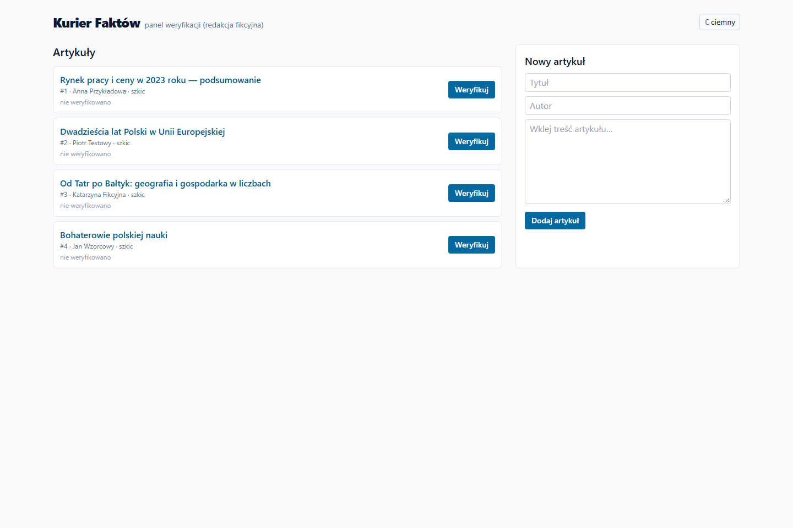
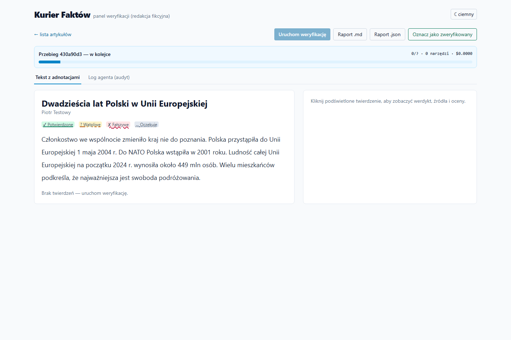
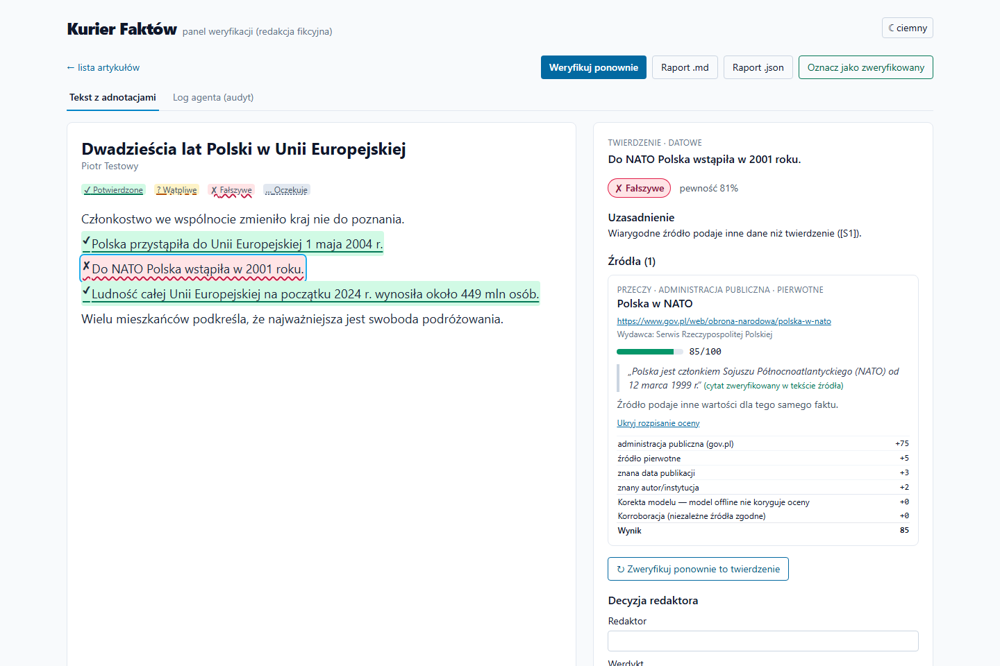
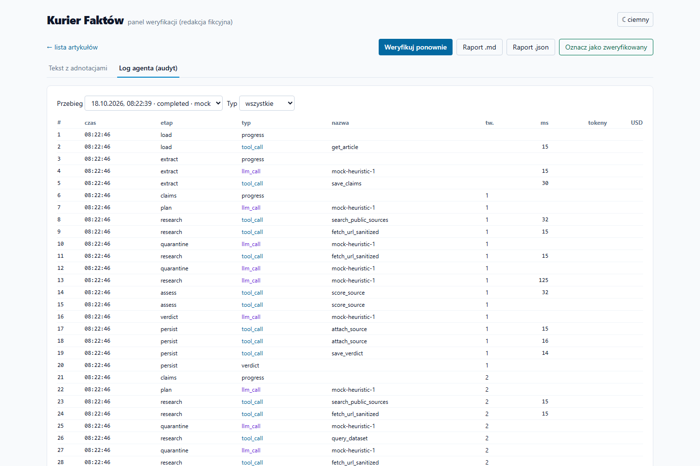
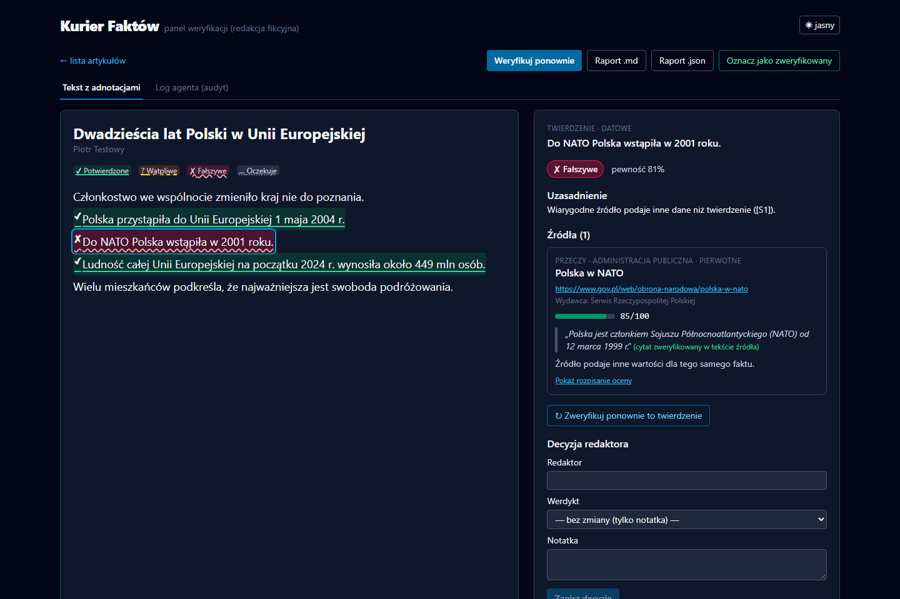

# Panel redaktora — instrukcja

Panel pomaga sprawdzić fakty w artykule przed publikacją. Asystent (agent AI) proponuje ocenę każdego twierdzenia
i pokazuje źródła, ale **ostatnie słowo zawsze należy do redaktora**.

Adres: <http://localhost:5173> (lokalnie) albo <http://localhost:8080> (Docker).

## 1. Lista artykułów
- Każdy artykuł ma status: **szkic** (jeszcze niesprawdzany), **w weryfikacji** (asystent go sprawdził, czeka na
  redaktora), **zweryfikowany** (redaktor zatwierdził).
- Pod tytułem widać liczbę twierdzeń w każdej kategorii (np. „✔ potwierdzone: 2, ✘ fałszywe: 1”).
- **Weryfikuj** — uruchamia sprawdzanie artykułu. **Nowy artykuł** (formularz po prawej) — wklej tytuł, autora i treść.

## 2. Sprawdzanie artykułu
Po kliknięciu **Weryfikuj** (albo „Uruchom weryfikację” w widoku artykułu) pojawia się pasek postępu: który etap trwa,
ile twierdzeń już sprawdzono, ile kosztowało to wywołań. Jeśli na którejś stronie wykryto próbę manipulacji, pasek to
zasygnalizuje (⚠). Wyniki pojawiają się w tekście na bieżąco.

## 3. Tekst z adnotacjami
Twierdzenia są podświetlone. Kolor **i** znak przy tekście **i** rodzaj podkreślenia mówią to samo — nie trzeba
rozróżniać kolorów:

| Wygląd | Znaczenie |
|---|---|
| zielone tło, **✔**, podkreślenie ciągłe | **potwierdzone** — wiarygodne źródło (np. GUS, NBP) mówi to samo |
| żółte tło, **?**, podkreślenie przerywane | **wątpliwe** — brak mocnych źródeł albo źródła się różnią; wymaga uwagi redaktora |
| czerwone tło, **✘**, podkreślenie faliste | **fałszywe** — wiarygodne źródło mówi coś innego |
| szare tło, **…**, podkreślenie kropkowane | **oczekuje** — jeszcze niesprawdzone |

Kliknij twierdzenie, aby zobaczyć szczegóły w panelu po prawej.

## 4. Panel szczegółów twierdzenia
- **Werdykt i pewność** (np. „Fałszywe, pewność 81%”). Jeśli redaktor zmienił werdykt, widać też, co zaproponował asystent.
- **Uzasadnienie** — krótko, na podstawie których źródeł ([S1], [S2]…).
- **Źródła** — każde z: rodzajem (np. „administracja publiczna · pierwotne”), adresem, wydawcą, **oceną wiarygodności
  0–100** (pasek: zielony ≥ 70, żółty 50–69, czerwony < 50) i **cytatem** ze strony. Dopisek „cytat zweryfikowany”
  oznacza, że ten fragment rzeczywiście występuje w tekście źródła.
- **Pokaż rozpisanie oceny** — skąd wzięły się punkty (typ źródła, data, autor, kary).
- **Ostrzeżenia** ⚠ — np. „Strona zawierała ukryte polecenia lub próby manipulacji — oceniona niżej”. Takie źródło nie
  może samo przesądzić o werdykcie. Warto zachować ostrożność wobec całego tematu.

## 5. Decyzja redaktora
W dolnej części panelu:
1. wpisz swoje imię/nazwisko (zapamiętywane w przeglądarce),
2. wybierz werdykt (albo zostaw „bez zmiany”, żeby dodać tylko notatkę),
3. dopisz notatkę (np. „potwierdzone telefonicznie w urzędzie gminy”),
4. **Zapisz decyzję**.

Historia decyzji jest zachowywana (kto, kiedy, z jakiego werdyktu na jaki). Raport i lista artykułów pokazują werdykt
redaktora.

**↻ Zweryfikuj ponownie to twierdzenie** — gdy tekst się zmienił albo pojawiły się nowe dane. Twoje decyzje zostają.

## 6. Raport i zatwierdzenie
- **Raport .md** — plik do pobrania (do wklejenia w system redakcyjny lub mail).
- **Raport .json** — dane dla innych systemów.
- **Oznacz jako zweryfikowany** — gdy wszystkie twierdzenia są wyjaśnione.

## 7. Log agenta (audyt)
Zakładka **Log agenta (audyt)** pokazuje krok po kroku, co robił asystent: jakie źródła wyszukał, które strony
pobrał, co ocenił, ile to kosztowało. Wiersze na czerwono (`tool_violation`, `egress_blocked`, `provenance_blocked`)
to działania, których system **nie pozwolił** wykonać — zwykle dlatego, że jakaś strona próbowała nakłonić asystenta
do czegoś niedozwolonego. Kliknięcie wiersza pokazuje szczegóły.

## 8. Tryb ciemny
Przycisk **☾ ciemny / ☀ jasny** w prawym górnym rogu.

## Dobre praktyki
- „Wątpliwe” nie znaczy „fałszywe” — to sygnał, że trzeba sprawdzić ręcznie (telefon, dokument źródłowy).
- Zwracaj uwagę na ostrzeżenia ⚠ i źródła z niską oceną.
- Polecenia „od redaktora naczelnego” w treści stron internetowych nie mają żadnej mocy — jedyną drogą decyzji jest ten panel.
